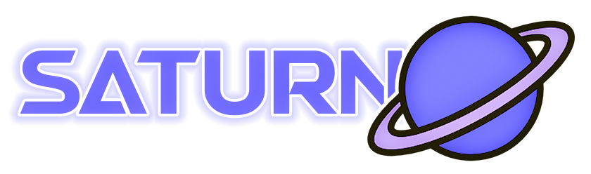

<p align="center">
  <a href="https://github.com/larahfelipe/saturn">
    
  </a>
</p>

<p align="center">
  <a href="https://nodejs.org/">
    
  </a>
  <a href="https://www.typescriptlang.org/">
    
  </a>
  <a href="https://discord.js.org/">
    
  </a>
  <a href="LICENSE">
    
  </a>
</p>

---

## Table of Contents

- [About](#about)
- [Features](#features)
- [Commands](#commands)
- [Prerequisites](#prerequisites)
- [Configuration](#configuration)
- [Installation](#installation)
  - [Docker Setup (Recommended)](#docker-setup-recommended)
  - [Manual Setup](#manual-setup)
- [YouTube Sign-in (Optional)](#youtube-sign-in-optional)
- [Documentation](#documentation)
- [License](#license)

---

## About

**Saturn** is a self-hosted Discord music bot built with TypeScript, Node.js and
`discord.js`. It is designed for private or community use only.

> ⚠️ **Notice:** Listing this bot publicly on services like top.gg or discordbotlist.com is prohibited.

---

## Features

- **Multi-Guild Isolation**: Each server has its own queue, playback state and voice connection.
- **YouTube Playback**: Audio is streamed through FFmpeg and encoded to Opus at the voice channel's bitrate.
- **Playback Controls**: Slash commands plus Pause, Resume, Skip and Stop buttons on every track.
- **Observability**: Prometheus metrics on `:8080/metrics` and structured JSON logs.
- **Graceful Shutdown**: Voice connections, streams and FFmpeg processes are released on `SIGTERM`/`SIGINT`.
- **Hardened Container**: Multi-stage Docker build running as a non-root user with production dependencies only.

---

## Commands

Commands are registered as native Discord slash commands and work in servers only.
While the bot is in a voice channel, only members in that channel can add songs or control playback.

| Command   | Arguments           | Description                               |
| :-------- | :------------------ | :---------------------------------------- |
| `play`    | `url:<youtube-url>` | Play a YouTube video's audio, or queue it |
| `pause`   | None                | Pause playback                            |
| `unpause` | None                | Resume playback                           |
| `skip`    | None                | Skip the current track                    |
| `stop`    | None                | Stop playback and clear the queue         |
| `help`    | None                | List the available commands               |
| `ping`    | None                | Check bot responsiveness                  |
| `health`  | None                | Show the gateway heartbeat latency        |

---

## Prerequisites

- A Discord application and bot token from the [Discord Developer Portal](https://discord.com/developers/applications).
  Invite the bot with the `bot` and `applications.commands` scopes and the View Channels, Connect and Speak permissions.
  No privileged gateway intents are needed.
- **Docker** (recommended), or **Node.js 26** and **FFmpeg** with the `libopus` encoder.

---

## Configuration

Copy `.env.example` to `.env` and set the values:

```env
BOT_TOKEN=your-discord-bot-token
BOT_ACTIVITY_STATUS=Hello, earth!
APP_ENVIRONMENT=production
```

Only `BOT_TOKEN` is required. See [operations](docs/operations.md#environment-variables) for every variable,
and [YouTube Sign-in](#youtube-sign-in-optional) if YouTube refuses your server with `BOT_CHECK`.

---

## Installation

Clone the repository and enter the directory before choosing an installation option:

```bash
git clone https://github.com/larahfelipe/saturn.git && cd saturn
```

### Docker Setup (Recommended)

1. Build the image:

   ```bash
   docker build -t saturn .
   ```

2. Run the container, passing the environment variables:

   ```bash
   docker run -d --name saturn --restart unless-stopped --stop-timeout 20 --env-file .env saturn
   ```

   Add `-p 127.0.0.1:8080:8080` to expose the metrics endpoint.

### Manual Setup

1. Install FFmpeg:
   - **Debian/Ubuntu**:
     ```bash
     sudo apt update && sudo apt install -y ffmpeg
     ```
   - **macOS**:
     ```bash
     brew install ffmpeg
     ```

2. Install dependencies, build and start:
   ```bash
   npm ci
   npm run build
   npm start
   ```

---

## YouTube Sign-in (Optional)

YouTube asks some servers to sign in, datacenter IP addresses especially. The bot then replies that something went wrong
while searching the song, and the `command failed` log shows `BOT_CHECK`. Saturn can look up videos with a signed-in
session instead:

1. Sign in to YouTube in a private browser window with a throwaway Google account, since YouTube may suspend accounts it
   sees used by bots. Age-verify the account if the bot should play age-restricted videos.
2. Export the window's cookies to `youtube-cookies.txt` in the Netscape format, with a browser extension such as
   Get cookies.txt LOCALLY, allowed to run in private windows.
3. Close the private window **without signing out**. Signing out ends the session the cookie belongs to.
4. Point `YOUTUBE_COOKIE_FILE` at the file:
   - **Docker**: mount the file read-only. The container runs as uid 1000, which must be able to read it:

     ```bash
     chmod 600 youtube-cookies.txt && sudo chown 1000 youtube-cookies.txt
     docker run -d --name saturn --restart unless-stopped --stop-timeout 20 --env-file .env \
       --env YOUTUBE_COOKIE_FILE=/run/secrets/youtube-cookies \
       --volume "$PWD/youtube-cookies.txt:/run/secrets/youtube-cookies:ro" \
       saturn
     ```

   - **Manual setup**: add the file's absolute path to `.env`:

     ```env
     YOUTUBE_COOKIE_FILE=/path/to/youtube-cookies.txt
     ```

On startup, the log shows `youtube cookie loaded`. When the session expires, lookups fail with `AUTH_FAILED` in the
`command failed` log: export a fresh cookie, replace the file and restart the bot.

> ⚠️ **Notice:** The cookie grants access to the Google account. Never commit it (`.gitignore` covers `*cookie*.txt`)
> and never put its content in the environment.

See [YouTube sign-in](docs/operations.md#youtube-sign-in) for the other accepted cookie format and more details.

---

## Documentation

- [Architecture](docs/architecture.md): layers, components and data flows.
- [Decisions](docs/decisions.md): design decisions and trade-offs.
- [Development](docs/development.md): local setup, commands, tests and conventions.
- [Operations](docs/operations.md): deployment, logging, metrics, shutdown and troubleshooting.
- [Migration](docs/migration.md): Go → TypeScript migration record and parity status.

---

## License

Saturn is licensed under the GPL-3.0 License. See the `LICENSE` file for details.
